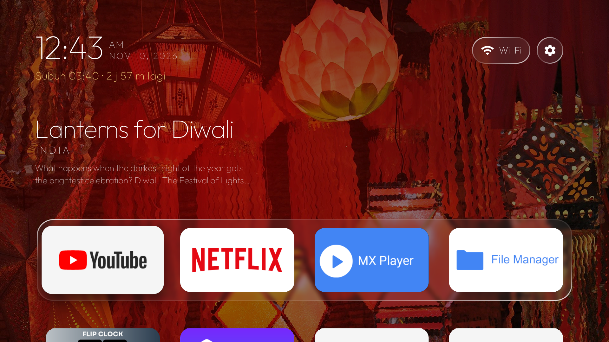
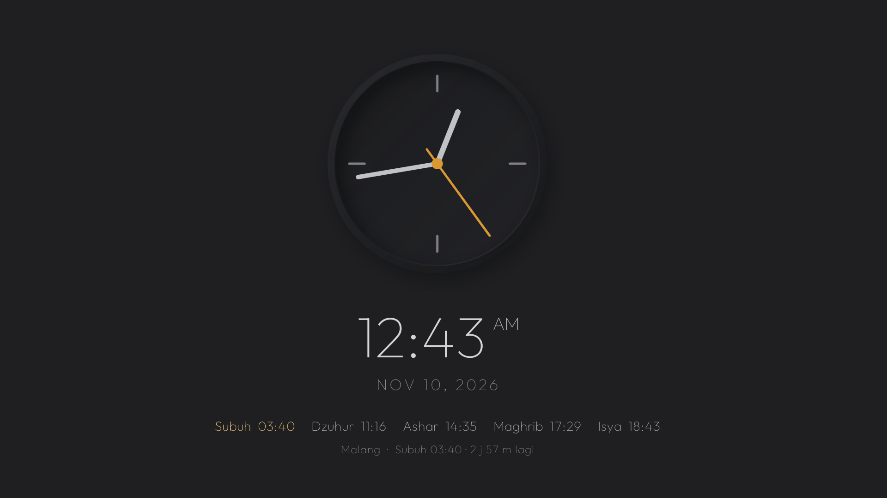

# Glass TV untuk Mi Box 3 — dengan Jadwal Sholat

Ganti Home Xiaomi Mi Box 3 (MDZ-16-AB, Android 9) yang penuh iklan dengan launcher bergaya kaca yang ringan. Jadwal sholat Kemenag tampil di bawah jam dan di screensaver. Tanpa root, sekitar 45–60 menit, dan bisa dikembalikan seperti semula dengan satu skrip.

| Home | Screensaver |
| --- | --- |
|  |  |

- **Jadwal sholat** dihitung di TV tanpa internet dengan kriteria Kemenag: Subuh 20°, Isya 18°, Ashar Syafi'i, ihtiyat +2 menit. Di bawah jam muncul waktu berikutnya dan hitung mundurnya. Screensaver menampilkan lima waktu, dan waktu berikutnya disorot emas.
- **Ringan:** RAM sekitar 26 MB, APK 312 KB. Gerakannya dibuat lebih tenang, dan efek blur kaca dihitung di ⅓ ukuran layar.
- **Aman:** Mi Box dicadangkan dulu. Launcher bawaan hanya dimatikan, tidak dihapus.

Cara ini juga bisa dipakai di Android TV lain dengan Android 8 ke atas (Mi Box S, Chromecast, TV TCL/Sony/Xiaomi).

## Isi repo

| File | Fungsi |
| --- | --- |
| `glass-tv-mibox.patch` | Modifikasi untuk [Glass TV](https://github.com/cocombee/glass-tv) versi `ce164b6`: jadwal sholat, mode hemat, dock |
| `backup-mibox.ps1` | Mencadangkan kondisi Mi Box (hanya membaca, tidak mengubah apa pun) |
| `pasang-mibox.ps1` | Memasang Glass TV sebagai Home, dengan pengaman otomatis bila gagal |
| `restore-mibox.ps1` | Mengembalikan Mi Box ke kondisi saat backup |

## Bahan

Semua bahan gratis. Unduhannya sekitar 650 MB.

| Bahan | Keterangan | Sumber |
| --- | --- | --- |
| Mi Box / Android TV | Android 8 ke atas, satu Wi-Fi dengan PC | — |
| PC Windows 10/11 | Ruang kosong ± 3 GB | — |
| Git (dengan Git Bash) | Untuk mengambil kode | [git-scm.com](https://git-scm.com/download/win) |
| JDK 17, Android SDK, adb | Dipasang lewat perintah di Langkah 2 | [adoptium.net](https://adoptium.net/), [developer.android.com](https://developer.android.com/tools/releases/platform-tools) |

## Langkah 1 — Siapkan Mi Box

1. Buka **Settings → Device Preferences → About**.
2. Arahkan ke **Build**, lalu tekan OK di remote 7 kali sampai muncul *"You are now a developer"*.
3. Buka **Device Preferences → Developer options**, lalu nyalakan **USB debugging**. Kalau ada **Network debugging**, nyalakan juga.
4. Catat IP Mi Box di **Settings → Network & Internet →** nama Wi-Fi yang tersambung. Contoh: `192.168.1.5`.

Ganti `192.168.1.5` dengan IP Mi Box Anda di setiap perintah di bawah.

## Langkah 2 — Pasang alat di PC

Semua alat dipasang ke folder pengguna, jadi tidak perlu hak admin.

**a.** Buka **PowerShell**, lalu tempel:

```powershell
$ProgressPreference='SilentlyContinue'; $dl="$env:TEMP\androiddl"; $sdk="$env:LOCALAPPDATA\Android\Sdk"
New-Item -ItemType Directory -Force $dl,$sdk,"$sdk\cmdline-tools" | Out-Null
Invoke-WebRequest "https://api.adoptium.net/v3/binary/latest/17/ga/windows/x64/jdk/hotspot/normal/eclipse" -OutFile "$dl\jdk17.zip"
Invoke-WebRequest "https://dl.google.com/android/repository/platform-tools-latest-windows.zip" -OutFile "$dl\pt.zip"
Invoke-WebRequest "https://dl.google.com/android/repository/commandlinetools-win-11076708_latest.zip" -OutFile "$dl\clt.zip"
Expand-Archive "$dl\jdk17.zip" "$env:LOCALAPPDATA\jdk-tmp" -Force
Move-Item (Get-ChildItem "$env:LOCALAPPDATA\jdk-tmp" -Directory)[0].FullName "$env:LOCALAPPDATA\jdk17"
Expand-Archive "$dl\pt.zip" $sdk -Force
Expand-Archive "$dl\clt.zip" "$sdk\clt-tmp" -Force
Move-Item "$sdk\clt-tmp\cmdline-tools" "$sdk\cmdline-tools\latest"
```

**b.** Buka **Git Bash**, lalu tempel. Perintah `yes` menyetujui lisensi Android SDK dari Google.

```bash
export JAVA_HOME="$LOCALAPPDATA/jdk17"; SDK="$LOCALAPPDATA/Android/Sdk"
yes | "$SDK/cmdline-tools/latest/bin/sdkmanager.bat" --sdk_root="$SDK" --licenses
"$SDK/cmdline-tools/latest/bin/sdkmanager.bat" --sdk_root="$SDK" "platforms;android-34" "build-tools;34.0.0"
```

## Langkah 3 — Ambil repo ini dan Glass TV, lalu terapkan patch

Di Git Bash:

```bash
cd /d && git clone https://github.com/pututjr/mibox-glass-tv.git && cd mibox-glass-tv
git clone -c core.longpaths=true https://github.com/cocombee/glass-tv.git
cd glass-tv && git checkout -q ce164b6 && git apply ../glass-tv-mibox.patch && echo "patch OK"
```

**Ganti kota (default Malang)** di `glass-tv/launcher/app/src/main/res/values/config.xml`. Koordinatnya bisa diambil dari Google Maps (klik kanan pada kota).

```xml
<string name="prayer_city" translatable="false">Malang</string>
<string name="prayer_lat" translatable="false">-7.9666</string>
<string name="prayer_lng" translatable="false">112.6326</string>
```

Contoh: Jakarta `-6.2088`, `106.8456`; Surabaya `-7.2575`, `112.7521`; Bandung `-6.9175`, `107.6191`. Aplikasi di dock diatur di `dock_apps` pada file yang sama.

## Langkah 4 — Backup Mi Box

Di PowerShell:

```powershell
cd D:\mibox-glass-tv
powershell -ExecutionPolicy Bypass -File backup-mibox.ps1 -TvHost 192.168.1.5
```

Pada percobaan pertama, TV menampilkan **Allow USB debugging?** Centang **Always allow from this computer**, tekan OK, lalu jalankan perintahnya sekali lagi. Hasilnya folder `backup-mibox-<tanggal>`, yang juga berisi `restore-mibox.ps1`.

## Langkah 5 — Build APK

Build pertama memakan 3–5 menit. Di Git Bash:

```bash
cd /d/mibox-glass-tv/glass-tv/launcher
printf 'sdk.dir=%s\n' "$(cygpath -m "$LOCALAPPDATA/Android/Sdk")" > local.properties
export JAVA_HOME="$LOCALAPPDATA/jdk17"
./gradlew.bat testReleaseUnitTest assembleRelease -q --console=plain
ls -la app/build/outputs/apk/release/app-release.apk
```

**Cek:** `app-release.apk` ada dan ukurannya sekitar 312 KB.

## Langkah 6 — Pasang sebagai Home

Di PowerShell:

```powershell
cd D:\mibox-glass-tv
powershell -ExecutionPolicy Bypass -File pasang-mibox.ps1 -TvHost 192.168.1.5
```

Skrip memasang APK, lalu membuka Glass TV dan mengecek bahwa ia jalan normal. Setelah itu Glass TV dijadikan Home, launcher bawaan dimatikan (bukan dihapus), dan screensaver jadwal sholat dipasang. Kalau ada langkah yang gagal, launcher bawaan otomatis dikembalikan.

**Cek:** keluar `Selesai. Home sekarang: com.gathin.tvhome/.MainActivity`. Tekan Home di remote asli: layar harus kembali ke Glass TV.

**Tips:** tahan OK pada aplikasi, pilih **Move**, lalu geser untuk mengatur urutan. Foto latar dari Bing muncul dalam satu menit setelah Mi Box tersambung ke internet.

## Kembali ke semula

```powershell
cd D:\mibox-glass-tv\backup-mibox-<tanggal>
powershell -ExecutionPolicy Bypass -File restore-mibox.ps1 -TvHost 192.168.1.5
```

Skrip ini menghapus Glass TV, menyalakan lagi aplikasi yang dimatikan, dan memulihkan launcher serta screensaver bawaan. Factory reset juga tetap bisa dipakai, karena tidak ada aplikasi sistem yang dihapus.

## Masalah umum

| Gejala | Solusi |
| --- | --- |
| `unauthorized` / `failed to authenticate` | Centang **Always allow** di TV, tekan OK, lalu ulangi perintah |
| `connection refused` / timeout | Cek USB debugging dan IP. PC dan Mi Box harus di Wi-Fi yang sama |
| `Filename too long` saat clone | Pakai `-c core.longpaths=true` seperti di Langkah 3 |
| `git apply` gagal | Pastikan sudah `git checkout ce164b6` |
| Lisensi SDK `not accepted` | Jalankan perintah lisensi di **Git Bash**, bukan PowerShell |
| Aplikasi tidak muncul di dock | Aplikasi itu tidak punya ikon TV. Ganti `dock_apps`, atau atur lewat **Move** |

## Kredit dan lisensi

- Launcher: [Glass TV](https://github.com/cocombee/glass-tv) oleh cocombee, berdasarkan [Clean Your TV](https://github.com/Gathin23/cleanyourtv) oleh Gathin. Keduanya berlisensi MIT.
- Font Outfit berlisensi SIL OFL. Rumus posisi matahari mengikuti [PrayTimes.org](http://praytimes.org/), dengan parameter kriteria Kemenag RI.
- Foto latar adalah gambar harian Bing. Foto yang memuat orang dilewati otomatis.
- Patch dan skrip di repo ini berlisensi MIT, lihat [LICENSE](LICENSE).
